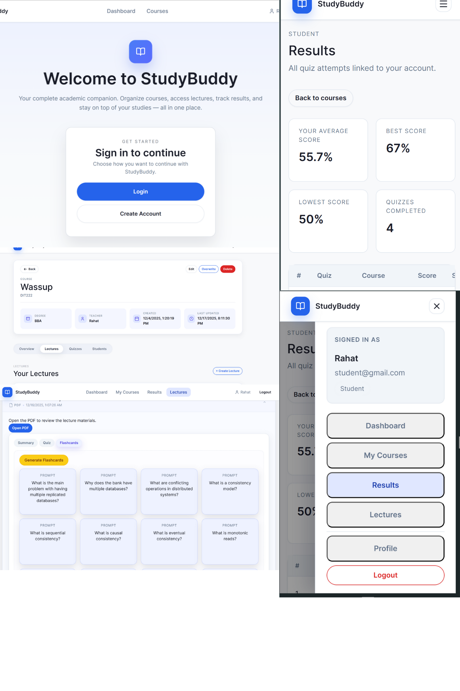

# StudyBuddy

A full-stack university study workspace for **courses, notes, quizzes and AI-assisted revision**.

Built as a team course project with **Vue 3, Node.js, Express and MongoDB**. It connects a responsive web client to a versioned REST API, combining authentication, data relationships, PDF processing and optional external AI generation.



## What it does

- Browse courses and manage enrolments and teaching assignments.
- Create and organise study notes.
- Create quizzes, participate in them and view results.
- Upload PDF course materials and extract text for revision tools.
- Generate summaries, multiple-choice questions and flashcards from notes or text-based PDFs.
- Authenticate users with hashed passwords and JWTs.

The revision tools use an optional server-side OpenAI integration. Without a configured key, or when the service is unavailable, the backend produces simple local fallback content. These fallbacks are basic study prompts rather than equivalent AI output.

## Architecture

| Layer | Technologies and responsibilities |
| --- | --- |
| Web client | Vue 3, Vue Router, Vite, BootstrapVueNext and Axios |
| REST API | Node.js, Express, JWT authentication and input/error handling |
| Data | MongoDB with Mongoose models and relationship endpoints |
| Study tools | PDF text extraction, optional OpenAI requests and structured quiz/flashcard responses |
| API checks | Postman collections executed with Newman |

Application endpoints live under `/api/v1`. The client currently targets `http://localhost:3000/api/v1`.

## Run locally

Use **Node.js 22**, npm and a running **MongoDB 6 or later** instance, matching the project's development setup.

```bash
git clone https://github.com/Lifelessdice/Study-Buddy.git
cd Study-Buddy
npm install --prefix server
npm install --prefix client
```

Create `server/.env` with development-only values:

```dotenv
MONGODB_URI=mongodb://127.0.0.1:27017/studybuddy
PORT=3000
JWT_SECRET=replace-with-a-long-random-development-secret
```

The app can run without an OpenAI key. To enable external generation, optionally configure `OPENAI_API_KEY` and `OPENAI_MODEL` in the **server environment**. Never commit real credentials.

Start the API:

```bash
npm run dev --prefix server
```

In a second terminal:

```bash
npm run serve --prefix client
```

Open the local URL printed by Vite. The API health endpoint is `http://localhost:3000/api/v1/health`.

## Development checks

```bash
npm run build --prefix client
npm test --prefix server
```

The API tests use and clear the local `serverTestDB` database; use a disposable local test database. These commands document available checks, not a claim that all checks currently pass.

See the [Postman collection](server/tests/server.postman_collection.json) and [API test guidance](server/docs/POSTMAN.md).

## Project scope

StudyBuddy is a university prototype and a record of team work. The [conceptual ER diagram](images/New_ER.png) includes a broader product vision: tasks and study groups remain planned concepts rather than implemented features in this version.

Production deployment would require further access-control review and deployment configuration. PDF revision tools require extractable text; scanned documents are not OCR-processed. Some older component/deployment documents retain course-template settings; use the local configuration above for this version.

## Explore the code

- [Web client](client/) — Vue application and reusable study components.
- [Backend](server/) — routes, controllers, models and study-tool services.
- [Conceptual data model](images/New_ER.png) — the broader product design.

## Team and attribution

Developed collaboratively as a university Web and Mobile Engineering project, building on the [DIT342 backend/frontend course template](https://git.chalmers.se/courses/dit342/group-00-web).

Rahat Mir's contributions include Postman API checks, shared note-validation and AI-handler refactoring, PDF-processing changes and responsive UI work. These are individual contributions within a shared team project.

See [LICENSE](LICENSE) for the repository's license.
